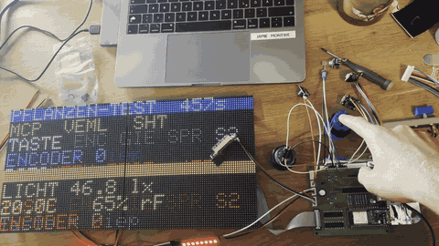
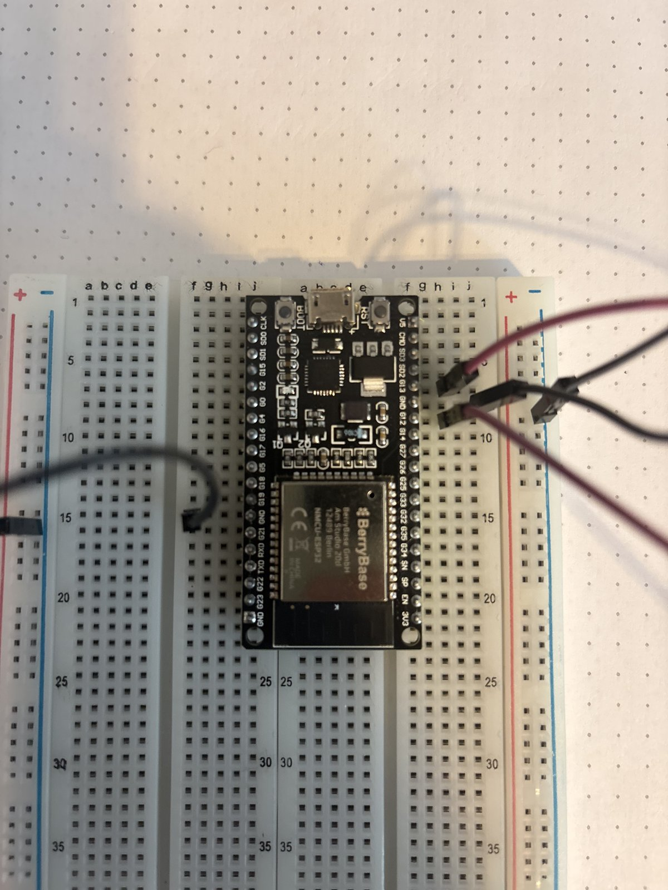
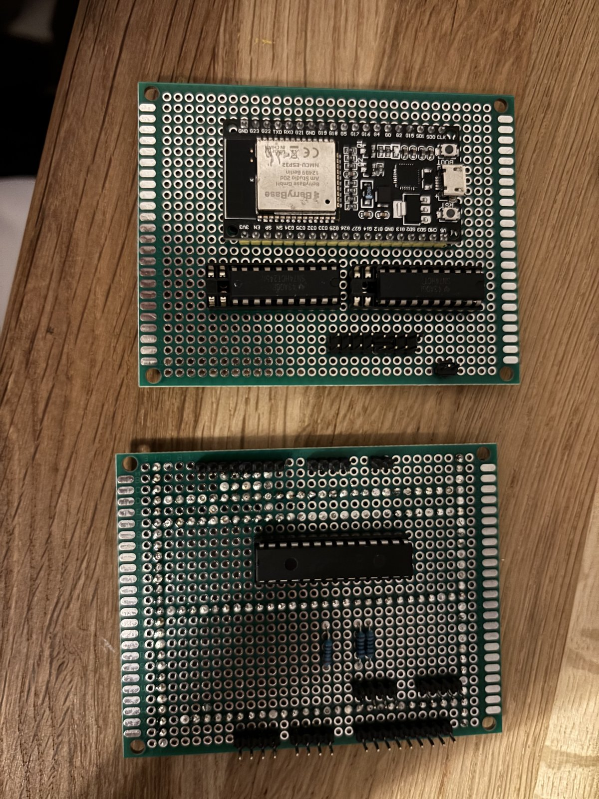
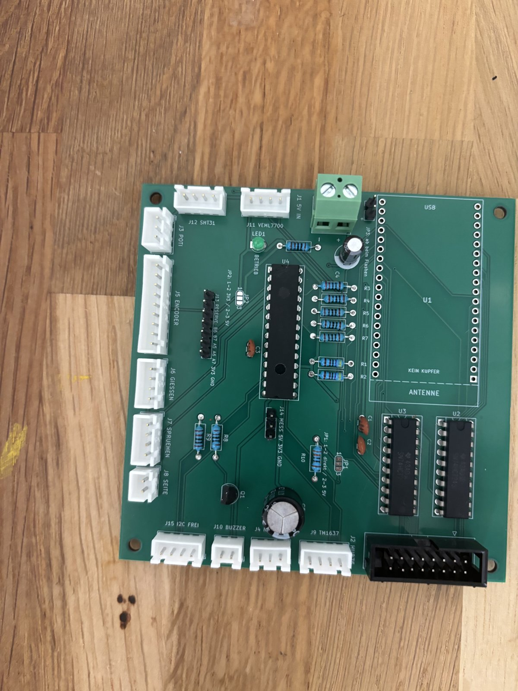
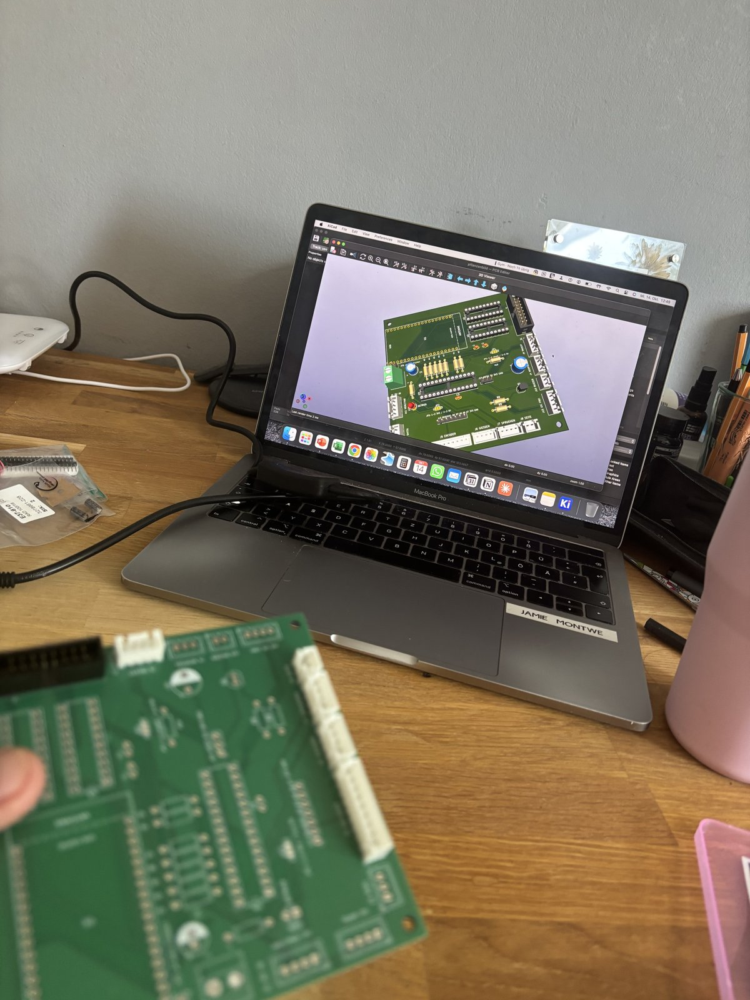

[README.md](https://github.com/user-attachments/files/34105280/README.md)
🌱 Plant Picture Frame

A picture frame showing a digital plant on two LED matrices (128 × 64 pixels). It reacts to real light, temperature and humidity, and you water and mist it with buttons on the frame.

**Status:** electronics working, final assembly in the frame in progress.
📄 **Build story as PDF:** [Plant_Picture_Frame.pdf](Plant_Picture_Frame.pdf)

## Build path

| Breadboard | Perfboard | Own PCB |
|---|---|---|
|  |  |  |

## Hardware

| Part | Role |
|---|---|
| ESP32 (NodeMCU) | Main controller |
| 2× HUB75 LED matrix | 128 × 64 px display |
| VEML7700 | Light sensor (I²C) |
| SHT31 | Temperature and humidity (I²C) |
| MCP23017 | Port expander for buttons and LEDs |
| Arcade buttons, rotary encoder, slider, buzzer | Input and feedback |
| TM1637 | 7-segment display |
| E-paper | Second display, driven by its own Arduino |
| Custom PCB | Designed in KiCad, 4 revisions, made by JLCPCB, hand soldered |
| Enclosure | Designed in Siemens NX, printed on a Prusa MK3S |

The LED panels get their own 5 V feed, so their current never runs through the logic board.

## Software

- C++ with the Arduino framework on the ESP32
- One small test sketch per component, then a full test that shows every sensor and button live on the matrix
- Sensors read directly over I²C, without extra libraries

## What I learned

- Labels and datasheets don't always match the actual hardware, so measure it yourself.
- I skipped the breadboard tests and soldered the ESP32 straight into a perfboard. Getting it back out meant desoldering every pin and fitting a new header. On the PCB it now sits in a socket.

## Coming next

- `pcb/` KiCad project
- `firmware/` test sketches and final firmware
- `cad/` enclosure model

---
Jamie Montwé · [LinkedIn](https://www.linkedin.com/in/jamie-montwe)
